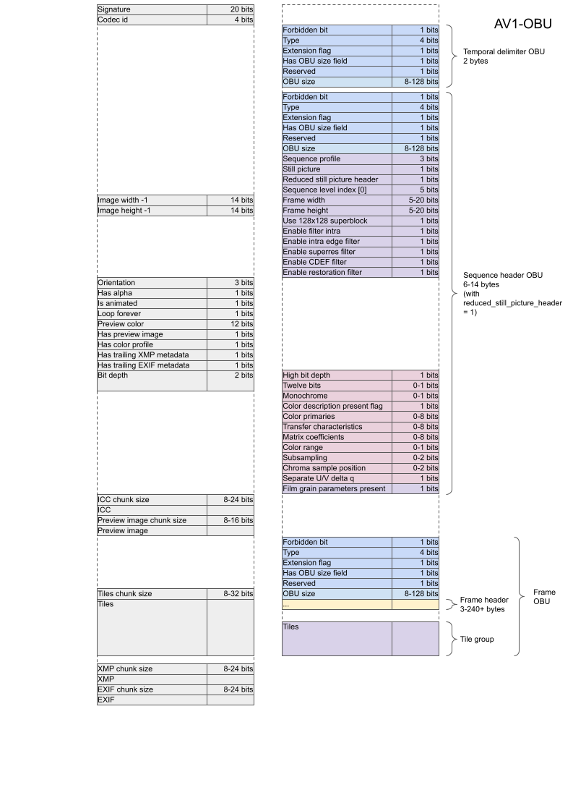
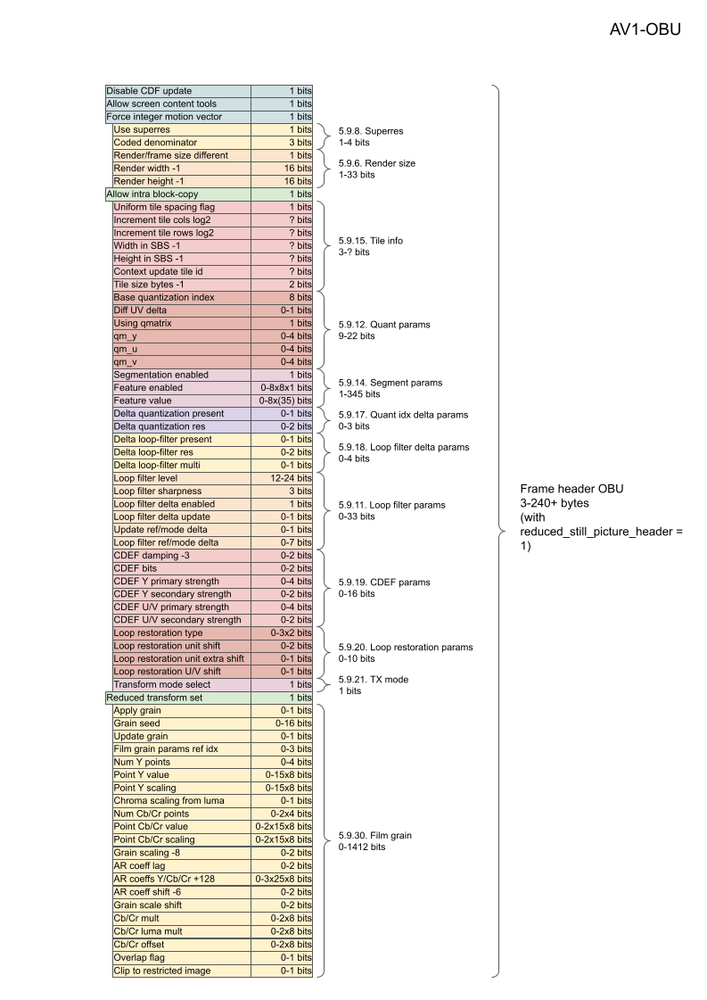

# Custom Simple Container

This repository contains a demo implentation of a strict minimal file structure.

## Objectives

The
[RIFF container](https://developers.google.com/speed/webp/docs/riff_container)
from WebP was not fully used. Some overhead can be reduced:

-   No need for hierarchy, a flat structure works.
-   Only signal what is needed to decode or skip the next chunk. Encoding the
    total file size is not needed.
-   No progressive decoding but a solid color signaled in the header and/or a
    preview chunk of a few hundred bytes.
-   Animation frame count is not stored. Each frame signals whether there is
    another one afterwards.
-   Drop niche loop count. An animation either plays once or loops infinitely.
-   Only the ICC profile is necessary before pixel decoding. XMP and EXIF
    metadata is located at the end of the bitstream.
-   Interleave alpha data within pixel chunks instead of having a separate
    cumbersome alpha chunk.
-   Spatially slice the image into independent tiles, to limit minimum memory
    usage and for easier encoding / decoding multithreading.

## Specification

### Coding

There are two ways of signaling a container value:

-   Bit-packing: append booleans as single bits and integers as bit sequences.
-   Variable-length integers: Each byte has one bit reserved, which is set to 1
    if another byte is needed to store the whole value. Up to 4 bytes.

### Chunks

A still image has the following chunks in order:

Chunk       | Optional | Content             | Coding
----------- | -------- | ------------------- | ---------------------------------
Header      | No       | Width/height etc.   | Bit-packing
Preview     | Optional | Image approximation | VarInt chunk size + encoded bytes
ICC profile | Optional | Color space         | VarInt chunk size + encoded bytes
First tile  | No       | Pixels              | VarInt chunk size + encoded bytes
...         | ...      | ...                 | ...
Last tile   | No       | Pixels              | VarInt chunk size + encoded bytes
XMP         | Optional | Appended as is      | VarInt chunk size + encoded bytes
EXIF        | Optional | Appended as is      | VarInt chunk size + encoded bytes

An animated image just adds ANMF separators, containing a frame's window and
duration, between tiles of different frames:

Chunk      | Optional | Content              | Coding
---------- | -------- | -------------------- | ---------------------------------
Header     | No       | Width/height etc.    | Bit-packing
Preview    | Optional | Image approximation  | VarInt chunk size + encoded bytes
ICC        | Optional | Color space          | VarInt chunk size + encoded bytes
**ANMF**   | **No**   | **Frame 0 features** | **Bit-packing + VarInt**
First tile | No       | Pixels of frame 0    | VarInt chunk size + encoded bytes
...        | ...      | ...                  | ...
Last tile  | No       | Pixels of frame 0    | VarInt chunk size + encoded bytes
**ANMF**   | **No**   | **Frame 1 features** | **Bit-packing + VarInt**
First tile | No       | Pixels of frame 1    | VarInt chunk size + encoded bytes
...        | ...      | ...                  | ...
Last tile  | No       | Pixels of frame 1    | VarInt chunk size + encoded bytes
XMP        | Optional | Appended as is       | VarInt chunk size + encoded bytes
EXIF       | Optional | Appended as is       | VarInt chunk size + encoded bytes

#### Header

Around 10-byte long, the main header contains the most important information
about the image, such as the format tag, width, height, orientation, is opaque,
is animated, tile size etc. \
It uses bit-packing for easy encoding and decoding on top of providing a fixed
header size.

Animations use a slightly longer header to also store the loop mode and the
background color. ANMF separators also use bit-packing.

#### Regular chunk

All remaining data is stored sequentially in regular chunks, whether it is a
preview, a tile, XMP etc. A chunk is preceded by its size encoded as a
variable-length integer, limiting it to ~500 megabytes.

## Library API

Work in progress. See [container.h](./container.h).

`WrapContainer()` and `UnwrapContainer()` functions can be used to encapsulate
encoded pixels in any format into a minimal image container. `EncodeRawPixels()`
and `DecodeRawPixels()` are just a convenient demo for a generic "codec".

### Build and test

```shell
mkdir ../container_build && \
cd ../container_build && \
cmake -DCMAKE_BUILD_TYPE=Debug ../container && \
make && \
ctest .
```

## Conversion from/to AVIF

AVIF is a MIAF/ISOBMFF wrapper around an OBU bitstream, which is itself usually
made of a sequence header, a frame header and an AV1 tile group.

Stripping everything but the AV1 tile group and the necessary fields in the
sequence and frame headers would produce lighter web image files:

-   Easy to parse and write,
-   No redundant field that could be contradictory and/or invalid (image
    dimensions stored in MIAF, sequence header and frame header),
-   Fewer features means low vulnerability,
-   Smaller files, especially for tiny images or icons.

### Convert tool

Work in progress.

1.  Start with an AVIF file (`avifenc img.png -o img.avif -c aom`).

2.  Convert from AVIF:

    ```shell
    ./convert img.avif -o img.pic
    ```

3.  Convert back to AVIF:

    ```shell
    ./convert img.pic -o img.avif
    ```

### OBU layout

Taken from https://aomediacodec.github.io/av1-spec.

Comparison between a minimal header (left) and a Sequence Header OBU (right):



Frame header OBU:


