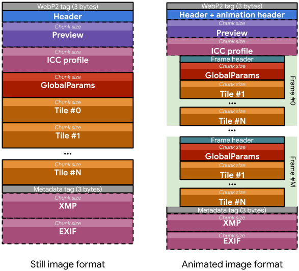

# WebP2 container

Disclaimer: Work in progress.

## Coding

There are two ways of signaling content:

-   Bit-packing: append booleans as single bits and integers as bit sequences.
-   Variable-length integers: Each byte has one bit reserved, which is set to 1
    if another byte is needed to store the whole value. Up to 4 bytes.

The descriptions below match the order of the chunks.

## Start tag

Hard-coded 3 bytes with the value 0x6ffff4.

## Image header

Using bit-packing, the main image header is 7 to 12-byte long:

Value                       | Bits |                                       |
--------------------------- | ---- | -------------------------------------
Width                       | 14   | In \[1:16384\]
Height                      | 14   | In \[1:16384\]
Orientation                 | 3    | 0°, 90°, 180°, 270° and/or mirror
Is opaque                   | 1    | If true: no alpha
Is animation                | 1    | If true: expect ANMF
Preview color               | 12   | RGB444
Has preview                 | 1    | If true: preview chunk
Has ICC profile             | 1    | If true: ICC chunk
Has XMP and/or EXIF         | 1    | If true: metadata tag
RGB bit depth               | 1    | 0 means 8-bit RGB, 1 means 10-bit RGB
Tile shape                  | 2    | 256x256, 512x512 etc.
Default transfer function   | 1    | If false: read custom
\[Transfer function\]       | 4    | If not default transfer func
\[Loop forever\]            | 1    | For animation only
\[Custom background color\] | 1    | For animation only
\[\[Background color\]\]    | 38   | For animation and custom bg only
Padding                     |      | Value 0

## Preview

This chunk exists only if signaled in the image header. \
The size of the preview chunk is stored as a variable-length integer. \
Raw encoded bytes follow.

## ICC profile

This chunk exists only if signaled in the image header. \
The size of the ICC profile chunk is stored as a variable-length integer. \
Raw bytes follow, verbatim.

## Frame header

Frame headers are only present if the image is animated (bit set to 1 in the
image header).

Using bit-packing, the frame header begins by storing 1 byte:

Value         | Bits |                                                    |
------------- | ---- | --------------------------------------------------
Dispose frame | 6    | Value is 0x33 (replace canvas by bg color) or 0x15
Blend         | 1    | Merge new pixels into canvas or replace them
Last frame    | 1    | Expect another frame after this one if true

Then using variable-length-integers, the frame header ends by storing 1 to 10
bytes:

Value                    | Range
------------------------ | -----------------------------------
Duration in milliseconds | \[0:32767\]
Frame width              | \[1:image width\]
Frame height             | \[1:image height\]
Frame position X         | \[0:(image width - frame width)\]
Frame position Y         | \[0:(image height - frame height)\]

Thus making each frame header 2 to 11-byte long.

## GlobalParams

The size of the GlobalParams chunk is stored as a variable-length integer, then
the encoded bytes are written. Those are not described here as they are not
related to the container. It contains whether the following tiles are lossless,
lossy or both, on top of other fields (alpha etc.).

There is one GlobalParams unit per still image or per frame in an animation.

## Frame tile

The size of a tile chunk is stored as a variable-length integer. \
Encoded pixels follow.

There is at least one tile per still image or per frame in an animation.

## Metadata tag

Hard-coded 3 bytes with the value 0x61ffe9 (XMP present), 0x62ffe9 (EXIF
present) or 0x63ffe9 (both present).

### XMP

This chunk exists only if signaled in the metadata tag. \
The size of the XMP chunk is stored as a variable-length integer. \
Raw bytes follow, verbatim.

### EXIF

This chunk exists only if signaled in the metadata tag. \
The size of the EXIF chunk is stored as a variable-length integer. \
Raw bytes follow, verbatim.
